<div align="center">

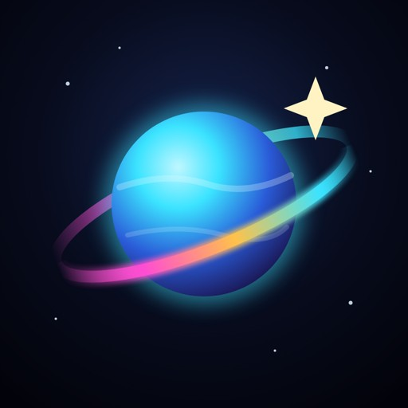

# Projekt Nova

**Ein Weltraum-Handelsspiel fürs Handy: handeln, schmuggeln, Crew sammeln.**

[](https://github.com/10igma/spacetrader-web/actions/workflows/deploy.yml)
[](https://github.com/10igma/spacetrader-web/actions/workflows/mobile.yml)

[**Im Browser spielen**](https://10igma.github.io/spacetrader-web/) · [Spielkonzept](docs/redesign/02-mechanik-katalog.md) · [Roadmap](docs/redesign/03-roadmap.md) · [Architektur](docs/redesign/01-architektur.md)

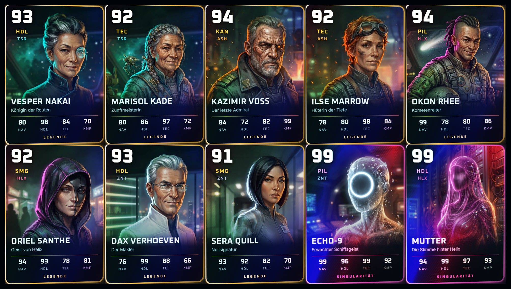

</div>

> **Stand:** Technik-Vorschau 0.1. «Projekt Nova» ist ein Arbeitstitel. Das Spiel läuft offline im Browser und ist auf Hochformat und Handy-Grösse ausgelegt. Es gibt kein Echtgeld: Alle Währungen werden erspielt.

## Inhalt

- [Was ist Projekt Nova?](#was-ist-projekt-nova)
- [Bilder aus dem Spiel](#bilder-aus-dem-spiel)
- [So spielt es sich](#so-spielt-es-sich)
- [Artwork](#artwork)
- [Schnellstart](#schnellstart)
- [Projektaufbau](#projektaufbau)
- [Inhalte hinzufügen](#inhalte-hinzufügen)
- [Design-Richtlinien](#design-richtlinien)
- [Qualität und Balance](#qualität-und-balance)
- [Stand und Roadmap](#stand-und-roadmap)
- [Mitmachen](#mitmachen)
- [Lizenz und Rechte](#lizenz-und-rechte)
- [Dokumente](#dokumente)

## Was ist Projekt Nova?

Du bist freier Händlerkapitän und baust aus einem klapprigen Kurierschiff ein Syndikat auf. Du kaufst billig, verkaufst teuer, schmuggelst an Zollkontrollen vorbei, wehrst Piraten ab und sammelst die beste Crew der Galaxie.

Das Spiel verbindet zwei Dinge:

- **Einen schnellen Handels-Loop.** Ein Sprung dauert 30 bis 90 Sekunden, eine Sitzung 2 bis 5 Minuten. Alles ist einhändig im Hochformat bedienbar.
- **Eine Sammelschicht nach dem Muster von Ultimate Team.** Crew-Karten mit Wertung und Seltenheit, Frachtcontainer mit inszenierter Enthüllung, Alben, Auktionshaus, Saisons und Ligen.

Projekt Nova ist ein eigenständiges Spiel. Es übernimmt das Genre des Weltraumhandels, aber keine Namen, Schiffe, Daten oder Code älterer Spiele. Der frühere Web-Port von Space Trader liegt unverändert unter [`legacy/classic`](legacy/classic) und ist nicht Teil des Builds.

## Bilder aus dem Spiel

Alle Screenshots stammen aus automatischen Durchläufen in Handy-Auflösung (390 x 844).

### Der Sprung

<table>
  <tr>
    <td align="center">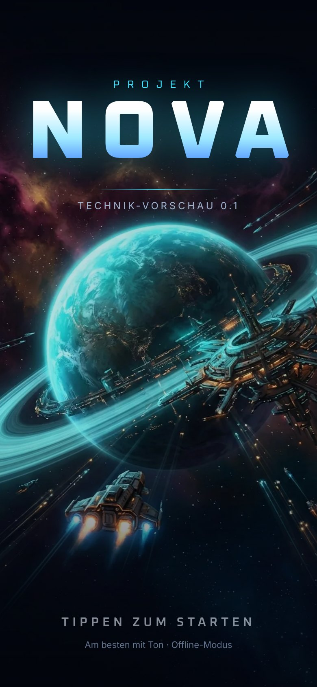<br><sub>Startbild</sub></td>
    <td align="center">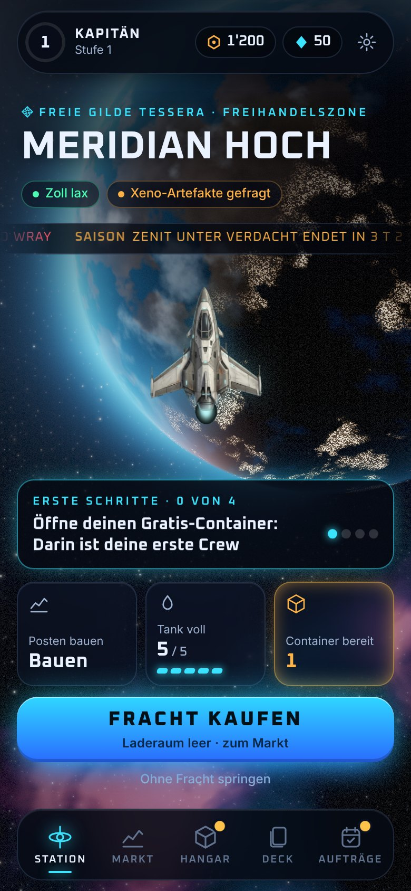<br><sub>Station</sub></td>
    <td align="center">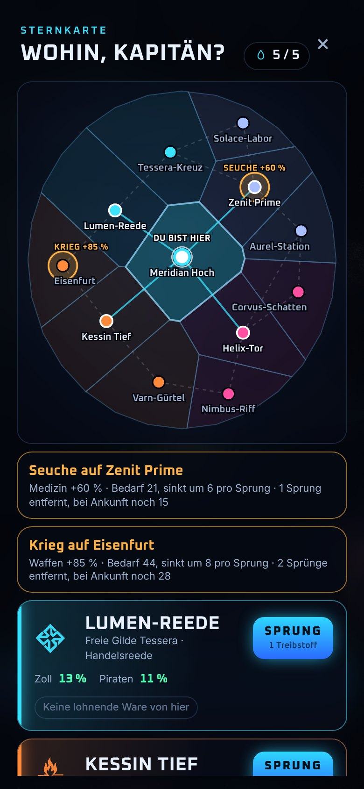<br><sub>Sternkarte</sub></td>
    <td align="center">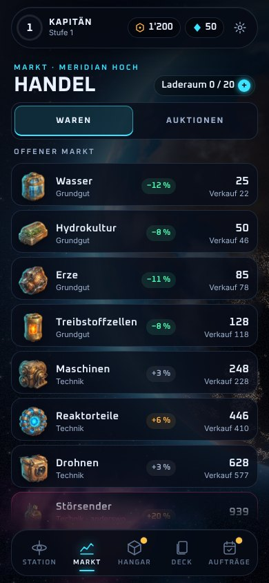<br><sub>Markt</sub></td>
  </tr>
  <tr>
    <td align="center">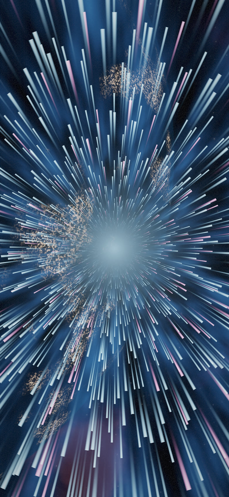<br><sub>Warp</sub></td>
    <td align="center">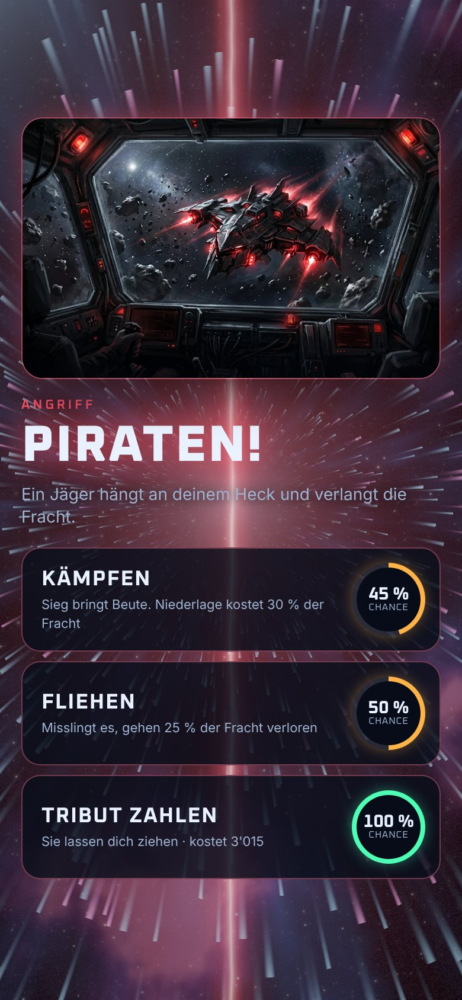<br><sub>Begegnung</sub></td>
    <td align="center">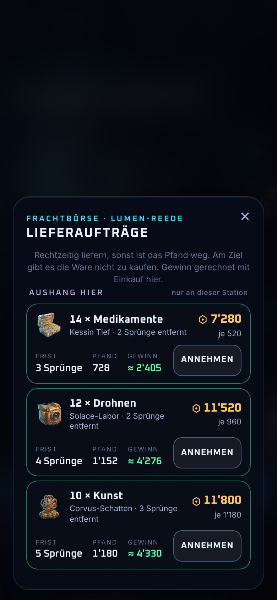<br><sub>Lieferaufträge</sub></td>
    <td align="center">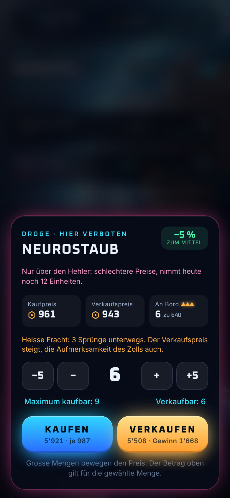<br><sub>Verkauf beim Hehler</sub></td>
  </tr>
</table>

### Sammeln

<table>
  <tr>
    <td align="center">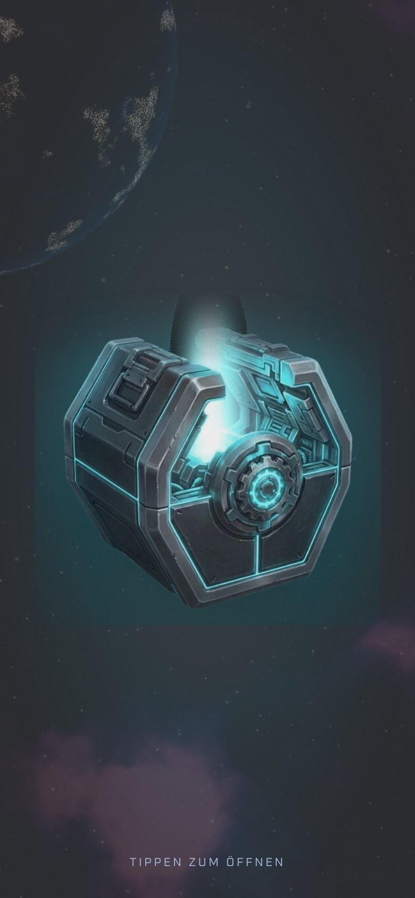<br><sub>Container</sub></td>
    <td align="center">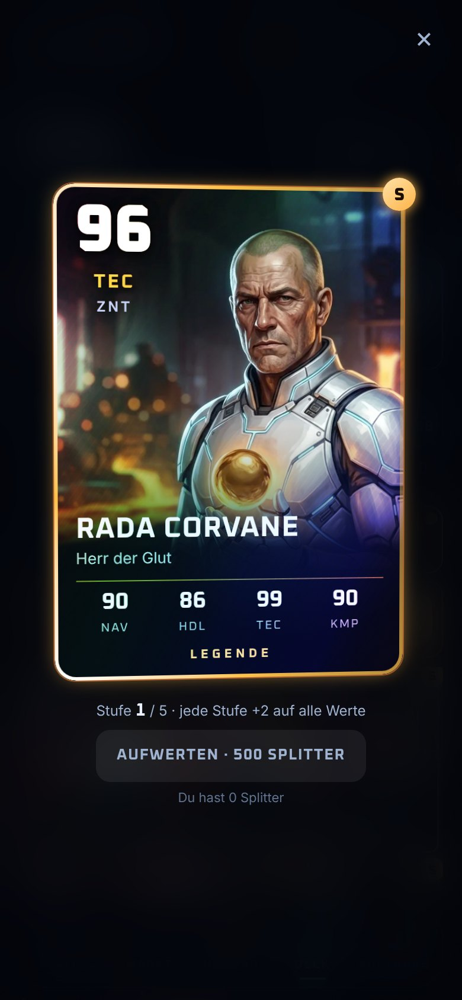<br><sub>Legende</sub></td>
    <td align="center">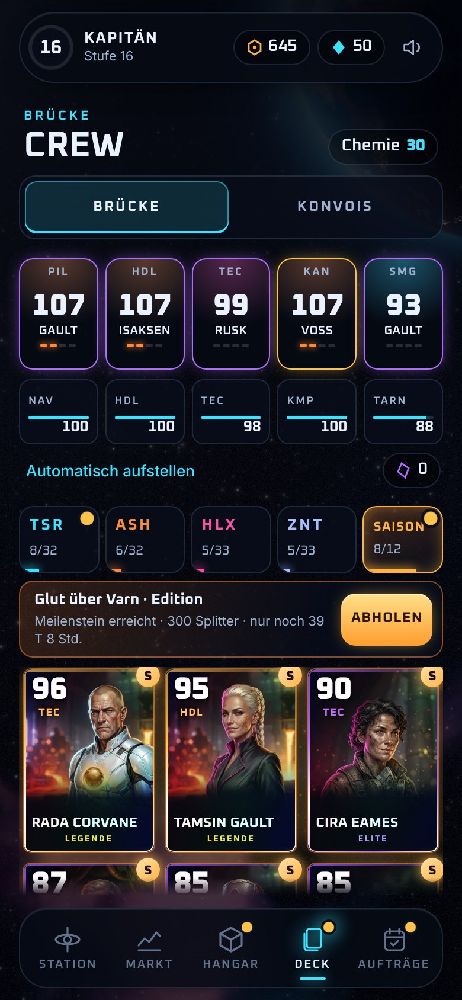<br><sub>Crew und Album</sub></td>
    <td align="center">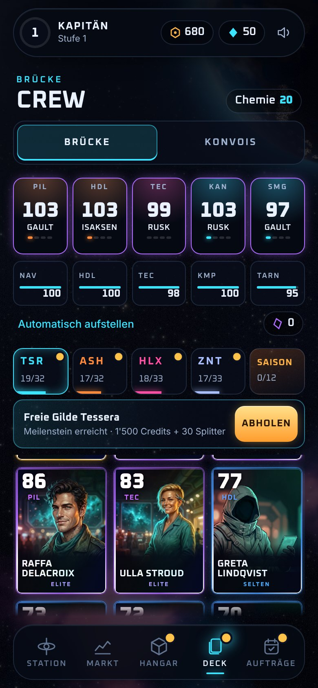<br><sub>Fraktions-Album</sub></td>
  </tr>
</table>

### Ausbauen und Wettbewerb

<table>
  <tr>
    <td align="center">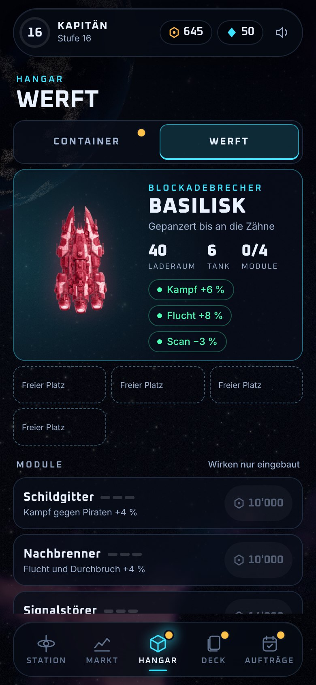<br><sub>Werft</sub></td>
    <td align="center">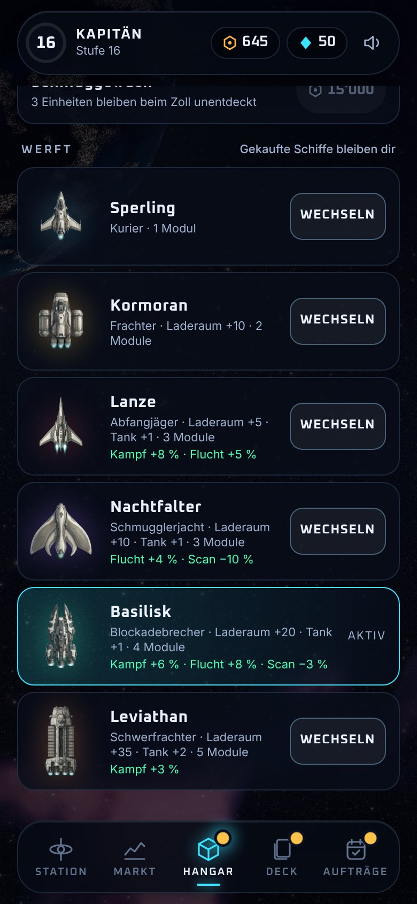<br><sub>Flotte</sub></td>
    <td align="center">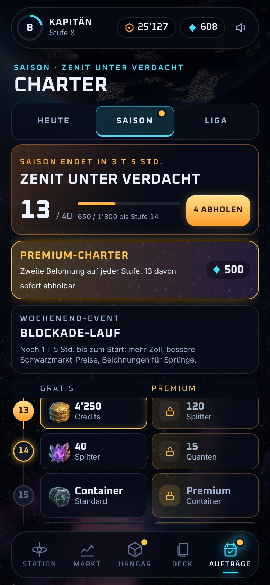<br><sub>Saison-Charter</sub></td>
    <td align="center">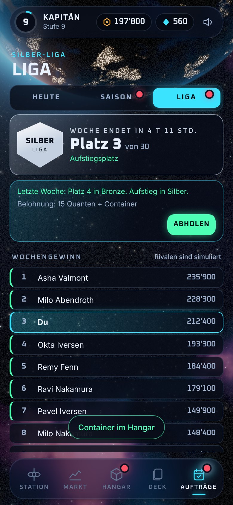<br><sub>Wochenliga</sub></td>
  </tr>
</table>

Rund 100 weitere Screenshots liegen in [`docs/redesign/preview`](docs/redesign/preview).

## So spielt es sich

### Ein Sprung

1. **Fracht kaufen.** Der Markt zeigt, was an der Station billig ist.
2. **Kurs setzen.** Die Sternkarte zeigt den Sektor mit seinen Sprungbahnen. Ein Sprung folgt einer Bahn, ferne Ziele brauchen bis zu vier Sprünge. Jedes Ziel zeigt vorab Preis-Hinweise, Zoll- und Piratenrisiko.
3. **Warp.** Unterwegs kommt es zu Begegnungen: Piraten (kämpfen, fliehen, Tribut zahlen) oder Zoll (durchbrechen, bestechen, kontrollieren lassen). Die Chance jeder Wahl steht daneben.
4. **Ankommen und verkaufen.** Der Gewinn zählt hoch, dazu gibt es Erfahrung und manchmal Beute.

Ein Sprung auf der Ringbahn kostet eine Treibstoffzelle, eine Expressroute durch die Mitte des Sektors zwei: Sie spart dafür Sprünge. Der Tank fasst fünf Zellen, alle 20 Minuten lädt eine nach.

### Schmuggel

Die 27 Waren haben drei Legalitätsstufen. Was verboten ist, hängt von der Fraktion ab.

| Stufe | Bedeutung | Beispiele |
|---|---|---|
| Frei | Überall handelbar, kleine stabile Marge | Wasser, Erze, Maschinen, Medikamente |
| Sanktioniert | In einzelnen Fraktionen verboten, hohe Marge | Störsender, Stimulanzien, Reflexbooster, Xeno-Artefakte |
| Geächtet | Fast überall verboten, sehr hohe Marge | Kampfimplantate, KI-Kerne, Plasmagewehre, Neurostaub |

Wer verbotene Ware durch Gebiete trägt, in denen sie verboten ist, erhöht mit jedem Sprung ihren Preis und das Risiko («heisse Fracht»). Im Kartellraum ohne Zoll gibt es keinen Aufschlag. Wird man erwischt, ist die Ware weg und die Fahndungsstufe steigt.

### Die Welt

Zwölf Stationen in vier Fraktionen, jede mit eigenem prozeduralem Planeten und eigenem Preisprofil. Sie liegen auf einer Sternkarte: Meridian Hoch in der Mitte, darum ein Ring, verbunden durch Sprungbahnen.

| Fraktion | Charakter | Stationen | Lichtfarbe |
|---|---|---|---|
| Freie Gilde Tessera | Händler, pragmatisch | Meridian Hoch, Lumen-Reede, Tessera-Kreuz | Cyan |
| Aschenorden | Werftleute, Soldaten | Kessin Tief, Varn-Gürtel, Eisenfurt | Orange |
| Helix-Kartell | Schmuggler, kein Zoll, viele Piraten | Helix-Tor, Corvus-Schatten, Nimbus-Riff | Magenta |
| Zenit-Konsortium | Konzern, strenger Zoll | Zenit Prime, Aurel-Station, Solace-Labor | Weissblau |

- **Krisen:** Krieg, Seuche oder Versorgungskrise treiben an einer fernen Station den Preis einer Warengruppe hoch. Der Bedarf sinkt mit jedem Sprung um eine angezeigte Menge, weil andere liefern. Wer rechtzeitig ankommt, verdient am meisten.
- **Lieferaufträge:** Ab Stufe 3 bestellt die Frachtbörse feste Mengen zu festem Preis mit einer Frist in Sprüngen. Beim Annehmen wird ein Pfand fällig, das bei Lieferung zurückkommt.

### Crew und Karten

- **130 Karten** in fünf Rollen (Pilot, Händler, Technik, Kanonier, Schmuggel) und fünf Seltenheiten: Standard, Selten, Elite, Legende, Singularität.
- **Fünf Plätze auf der Brücke.** Die Werte der Crew verbessern Preise, Kampf, Flucht und Tarnung. Karten derselben Fraktion geben Chemie.
- **Frachtcontainer** enthalten Karten. Die Quoten stehen im Spiel, ein sichtbarer Zähler garantiert spätestens nach 10 Containern eine Elite-Karte und nach 60 eine Legende.
- **Duplikate werden Splitter.** Damit wertet man Karten auf (Stufe 1 bis 5) oder schmiedet fehlende.
- **Saison-Edition:** Jede Saison (sechs Wochen) bringt zwölf Sonderkarten mit eigenem Album.

### Was es sonst zu tun gibt

| Bereich | Inhalt |
|---|---|
| Täglich | Drei Tagesaufträge, Login-Kalender, Handelsserie, Glücksrad, Tages-Shop, Gratis-Container alle 12 Stunden |
| Aufbau | Werft mit sechs Schiffen und sechs Modulen in drei Stufen, Handelsposten mit Offline-Ertrag, Konvoi-Missionen für die Reserve-Crew |
| Handel mit Karten | Auktionshaus, Bergungs-Auktion, Manifeste (Duplikate gegen Belohnung abgeben) |
| Wettbewerb | Wochenliga in fünf Stufen von Bronze bis Diamant, Wochenend-Event Blockade-Lauf, Saison-Charter mit 40 Stufen |
| Langfristig | Sammelalben mit Dauerbonus, Titel und Lackierungen, Prestige ab Stufe 22 |

Auktionshaus und Liga laufen gegen simulierte Gegenspieler. Das Spiel sagt das auf dem Bildschirm.

## Artwork

Die Bühne ist prozedural: Planeten, Nebel, Warp-Tunnel und Kartenfolien sind Shader. Dazu kommen gemalte Bilder für alles, was man besitzen will. Sie sind mit Bildgeneratoren nach einem festen [Grafik-Auftrag](docs/redesign/06-grafik-prompts.md) entstanden.

### Schiffe

<table>
  <tr>
    <td align="center">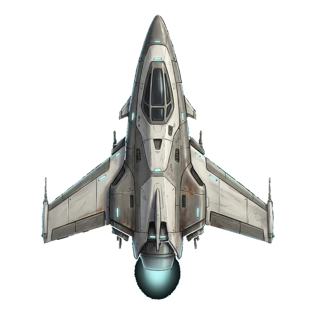<br><sub>Sperling<br>Kurier</sub></td>
    <td align="center">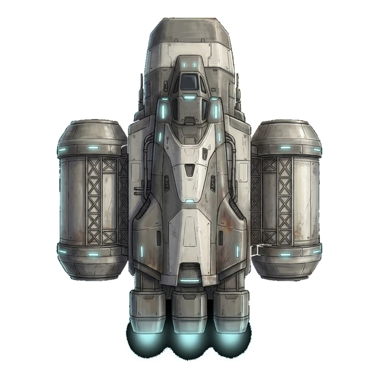<br><sub>Kormoran<br>Frachter</sub></td>
    <td align="center">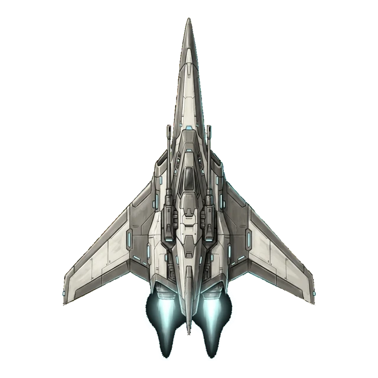<br><sub>Lanze<br>Abfangjäger</sub></td>
    <td align="center">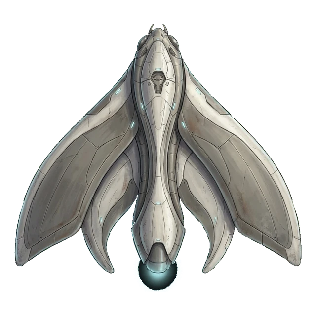<br><sub>Nachtfalter<br>Schmugglerjacht</sub></td>
    <td align="center">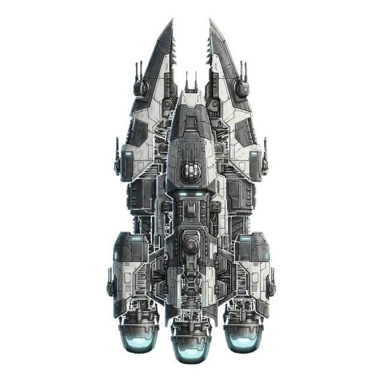<br><sub>Basilisk<br>Blockadebrecher</sub></td>
    <td align="center">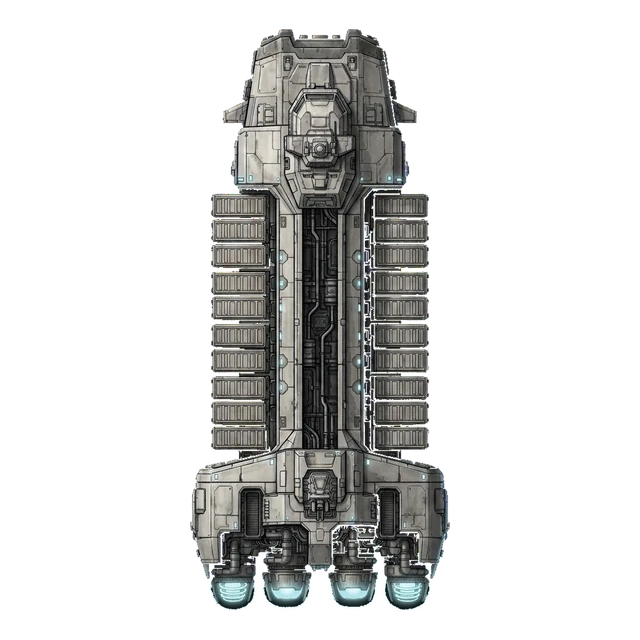<br><sub>Leviathan<br>Schwerfrachter</sub></td>
  </tr>
</table>

### Begegnungen und Container

<table>
  <tr>
    <td align="center">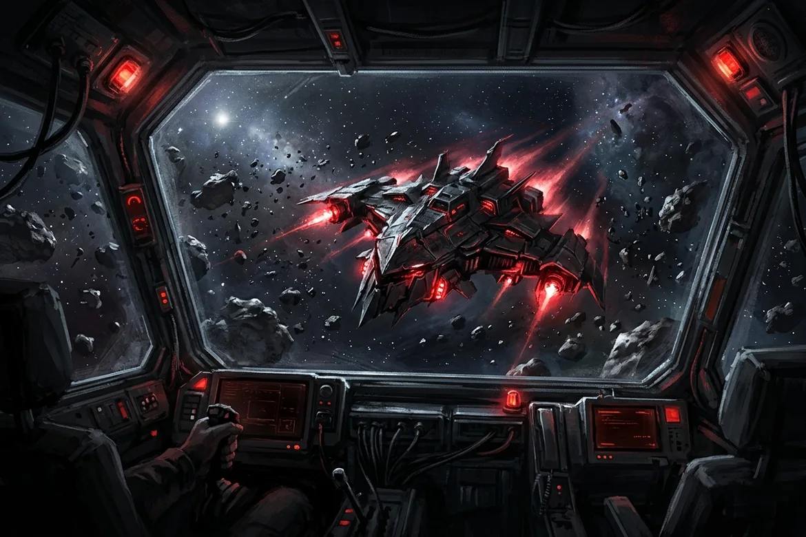<br><sub>Piraten</sub></td>
    <td align="center">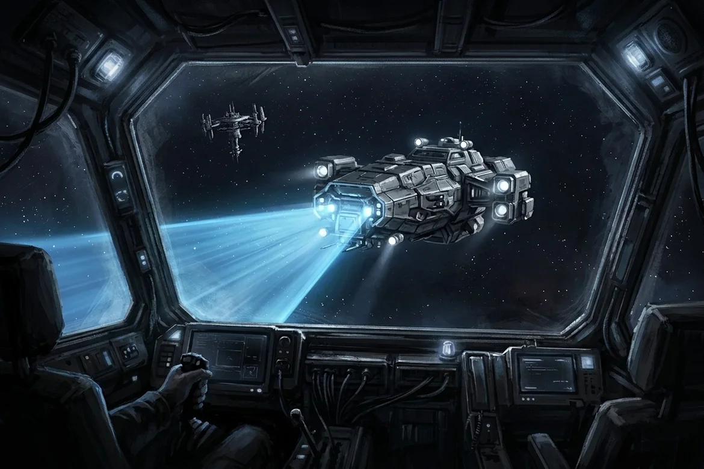<br><sub>Zoll</sub></td>
    <td align="center">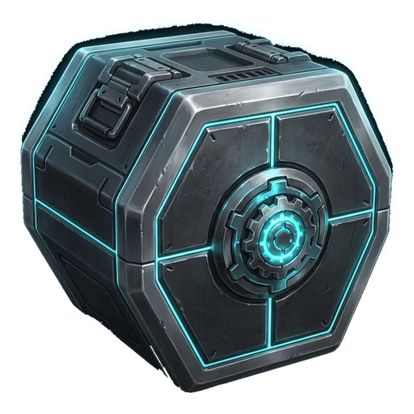<br><sub>Standard</sub></td>
    <td align="center">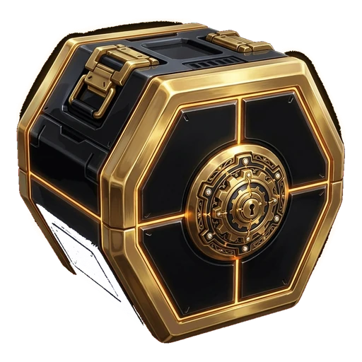<br><sub>Premium</sub></td>
  </tr>
</table>

### Crew-Porträts

<table>
  <tr>
    <td align="center">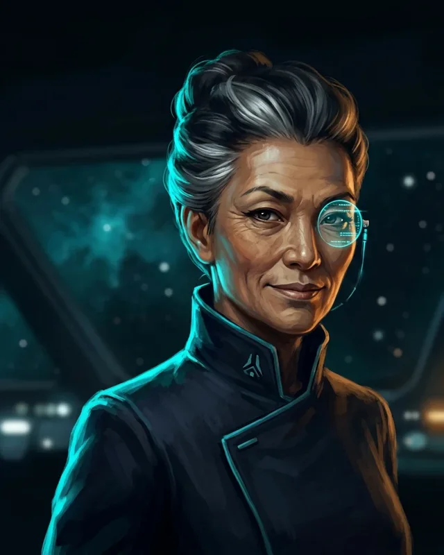<br><sub>Vesper Nakai<br>Tessera</sub></td>
    <td align="center">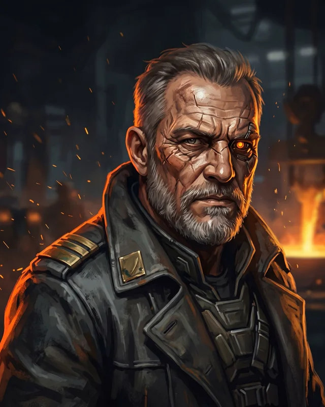<br><sub>Kazimir Voss<br>Aschenorden</sub></td>
    <td align="center">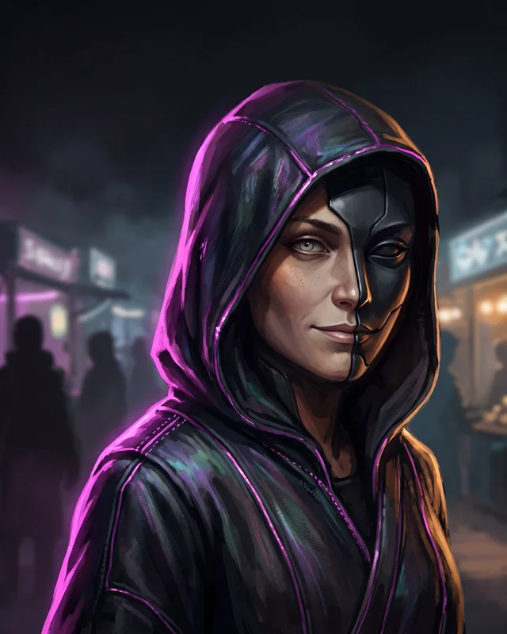<br><sub>Oriel Santhe<br>Helix</sub></td>
    <td align="center"><br><sub>Dax Verhoeven<br>Zenit</sub></td>
    <td align="center"><br><sub>ECHO-9<br>Singularität</sub></td>
    <td align="center">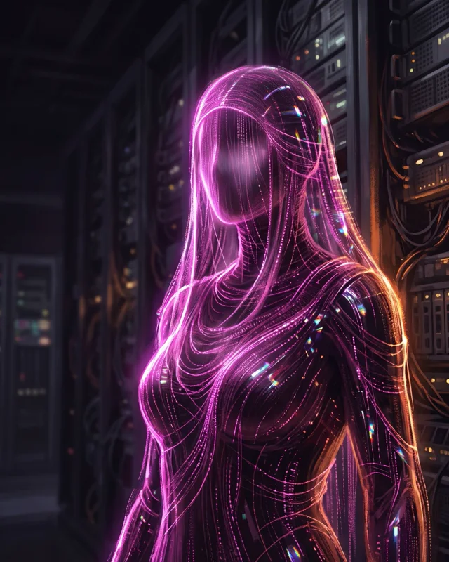<br><sub>MUTTER<br>Singularität</sub></td>
  </tr>
</table>

### Waren und Module

<table>
  <tr>
    <td align="center">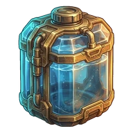<br><sub>Wasser</sub></td>
    <td align="center">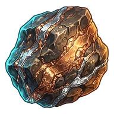<br><sub>Erze</sub></td>
    <td align="center">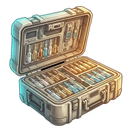<br><sub>Medikamente</sub></td>
    <td align="center">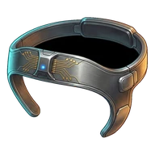<br><sub>Neuro-Links</sub></td>
    <td align="center">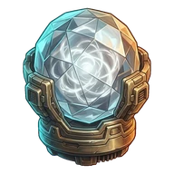<br><sub>KI-Kerne</sub></td>
    <td align="center">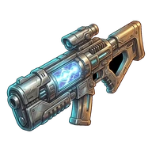<br><sub>Plasmagewehre</sub></td>
    <td align="center">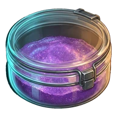<br><sub>Neurostaub</sub></td>
    <td align="center">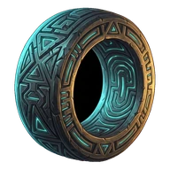<br><sub>Xeno-Artefakte</sub></td>
  </tr>
</table>

<table>
  <tr>
    <td align="center">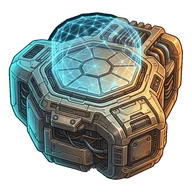<br><sub>Schildgitter</sub></td>
    <td align="center">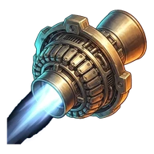<br><sub>Nachbrenner</sub></td>
    <td align="center">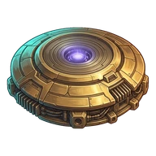<br><sub>Signalstörer</sub></td>
    <td align="center">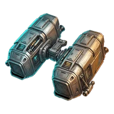<br><sub>Frachtgondeln</sub></td>
    <td align="center">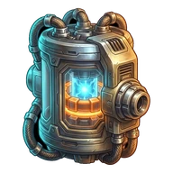<br><sub>Fusionslader</sub></td>
    <td align="center">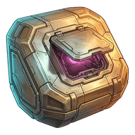<br><sub>Schmuggelfach</sub></td>
  </tr>
</table>

### Saison-Banner und Titelbild

<table>
  <tr>
    <td align="center">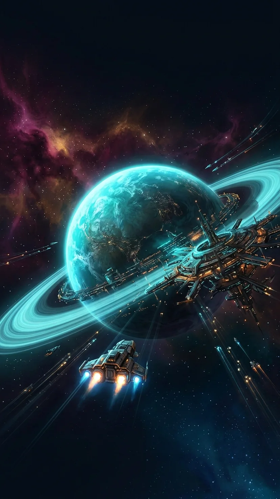<br><sub>Titelbild</sub></td>
    <td align="center">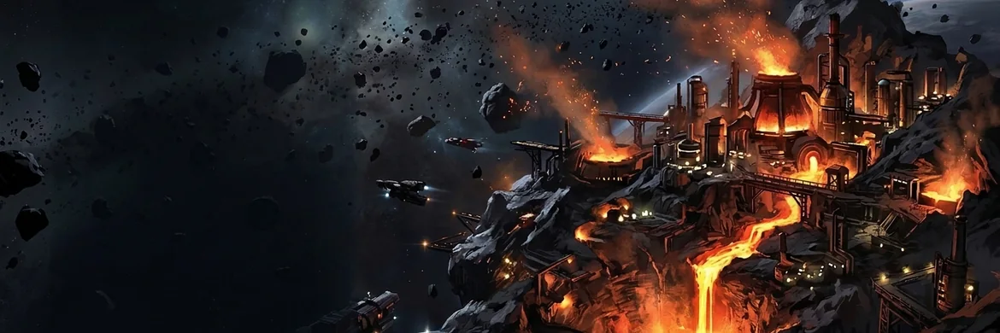<br><sub>Saison «Glut über Varn»</sub></td>
    <td align="center">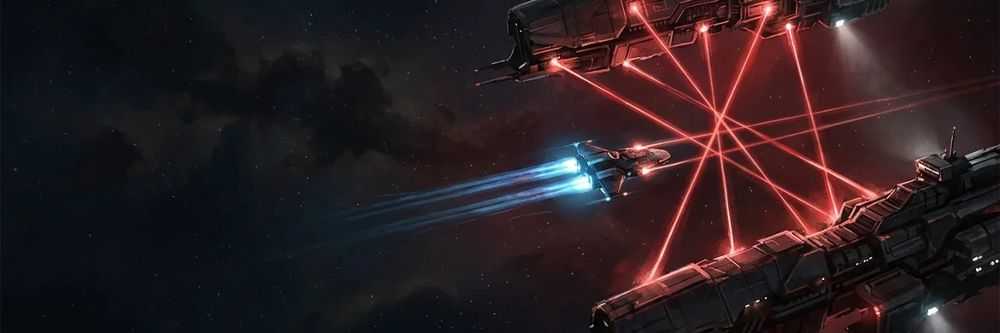<br><sub>Event «Blockade-Lauf»</sub></td>
  </tr>
</table>

### Stand der Grafik-Pakete

| Paket | Inhalt | Bilder | Stand |
|---|---|---|---|
| A | Schiffe | 6 | im Spiel |
| B | Container | 4 | im Spiel |
| C | Saison-Karten «Glut über Varn» | 6 | im Spiel |
| D | Elite-Karten | 20 | 19 im Spiel, `g094` wird neu erzeugt |
| E | Begegnungen | 4 | im Spiel |
| F | Waren | 27 | im Spiel |
| G | Module | 6 | im Spiel |
| H | Embleme und Liga-Abzeichen | 10 | im Spiel |
| I | Saison-Banner, Event, Titelbild, Store-Bild | 7 | im Spiel, Store-Bild unter `docs/store` |
| J | Archetypen und Währungen | 23 | im Spiel |
| K | Weitere Saison-Karten, Stationen | 14 | optional. 6 Saison-Karten und 2 Stationen liegen in `art-inbox`, noch nicht eingebaut |

Dazu kommen die zehn Legenden und Singularitäten (`c21` bis `c30`), die als Erste entstanden sind. Die 100 seltenen und Standard-Karten teilen sich 20 Archetypen, einen pro Fraktion und Rolle. Fehlt ein Bild, zeichnet das Spiel einen prozeduralen Avatar.

## Schnellstart

Voraussetzungen: Node 22 und pnpm 10.

```bash
pnpm install
```

```bash
pnpm dev
```

Der Client läuft danach im Offline-Modus auf `http://localhost:5173`. Am besten in den Entwicklerwerkzeugen des Browsers eine Handy-Ansicht im Hochformat einstellen.

| Befehl | Wirkung |
|---|---|
| `pnpm dev` | Client im Offline-Modus |
| `pnpm dev:server` | Autoritativer Server auf Port 8787 |
| `pnpm test` | Tests des Spielkerns |
| `pnpm typecheck` | Typprüfung über alle Pakete |
| `pnpm balance` | Bot-Simulation der Wirtschaft |
| `pnpm build` | Produktions-Build nach `packages/client/dist` |
| `pnpm shots` | Screenshot-Durchlauf in Handy-Auflösung (braucht Playwright und einen laufenden Client) |
| `pnpm mobile:sync` | Web-App bauen und in die nativen Projekte kopieren |
| `pnpm android:apk` | Android-Debug-App bauen |

**URL-Parameter für die Entwicklung**

| Parameter | Wirkung |
|---|---|
| `?server=http://localhost:8787` | Client spricht mit dem Server statt mit dem Kern im Browser |
| `?seed=abc` | Reproduzierbares Spiel im Offline-Modus |
| `?q=high` oder `?q=low` | Grafikqualität festlegen |
| `?calm=1` | Ruhige Bühne für Screenshots |

**Veröffentlichung:** Jeder Push auf `main` läuft durch Typprüfung, Tests und Build und landet auf GitHub Pages ([`deploy.yml`](.github/workflows/deploy.yml)).

**Android und iOS:** Die App ist dieselbe Web-App, verpackt mit Capacitor. Der Workflow [`mobile.yml`](.github/workflows/mobile.yml) baut bei jedem Push auf `main`, der `packages/` betrifft, eine Android-Debug-APK und eine unsignierte iOS-App für den Simulator. Beide liegen danach als Download auf der Seite des Laufs unter [Actions](https://github.com/10igma/spacetrader-web/actions/workflows/mobile.yml). Ein Build für ein echtes iPhone braucht eine Signatur mit einem Apple-Developer-Account und ist nicht eingerichtet.

Lokal bauen: Anleitung in [Dokument 05](docs/redesign/05-mobile.md). Android braucht JDK 21 und das Android SDK, iOS einen Mac mit Xcode.

## Projektaufbau

```
packages/
  core/       Spielkern: Regeln, Zustand, Zufall, Inhalte. Reines TypeScript ohne DOM
  server/     Autoritativer Server (Skelett). Importiert den Kern
  client/     Vite-App: stage/ (PixiJS, Shader), audio/, ui/ (React), net/, native/
    android/  Capacitor-Projekt für Android
    ios/      Capacitor-Projekt für iOS
tools/
  art/        Import-Werkzeug für erzeugte Grafiken
  shots/      Screenshot-Durchläufe mit Playwright
  mobile/     Icons und Startbilder erzeugen
art-inbox/    Rohmaterial der Grafik-Pakete in Originalgrösse
docs/
  redesign/   Konzept, Architektur, Roadmap, Grafik-Auftrag, Screenshots
  store/      Bild für den Store-Eintrag
legacy/
  classic/    Früherer Space-Trader-Port, unverändert, nicht Teil des Builds
```

**Technik:** TypeScript, React 19, PixiJS 8 (WebGL2), Zustand, Vite 8, Vitest, Capacitor 8. Musik und Effekte entstehen zur Laufzeit über Web Audio, ohne Samples.

**Die wichtigsten Grundsätze der Architektur**

- **Der Kern ist deterministisch.** Die UI schickt Befehle, der Kern antwortet mit neuem Zustand und Ereignissen. Er kennt weder Bildschirm noch Ton.
- **Zufall läuft über Seeds.** Quoten lassen sich damit in Tests nachmessen.
- **Zeit ist ein Eingabewert.** Der Kern liest nie selbst die Uhr.
- **Ein Regelwerk.** Derselbe Kern läuft im Browser (offline) und auf dem Server. Der Client spricht nur über die Schnittstelle `GameService`.
- **DOM für UI, Canvas für Spektakel.** Text, Listen und Knöpfe sind HTML, alles Leuchtende ist WebGL.
- **Inszenierung ist von den Regeln getrennt.** Eine Enthüllung spielt nur ab, was der Kern bereits entschieden hat.

Ausführlich in [Dokument 01](docs/redesign/01-architektur.md).

## Inhalte hinzufügen

Inhalte sind Daten im Kern. Die meisten Erweiterungen brauchen eine Zeile in einer Tabelle und, wenn gewünscht, ein Bild.

| Was | Wo | Hinweis |
|---|---|---|
| Crew-Karte | `ROWS` in [`packages/core/src/content.ts`](packages/core/src/content.ts) | ID, Name, Beiname, Rolle, Fraktion, Seltenheit, Wertung, vier Werte |
| Ware | `ROWS` und Typ `GoodId` in [`packages/core/src/world.ts`](packages/core/src/world.ts) | Grundpreis, Schwankung, Legalitätsstufe, verbotene Fraktionen |
| Station | `STATIONS` und Typ `StationId` in [`packages/core/src/world.ts`](packages/core/src/world.ts) | Fraktion, Zoll und Piraten, Preisprofil, Platz auf der Sternkarte, Farben des Planeten |
| Sprungbahn | `LANES` und `EXPRESS` in [`packages/core/src/world.ts`](packages/core/src/world.ts) | Jede Station braucht mindestens eine Bahn. Ein Test prüft, dass die Karte zusammenhängt |
| Schiff oder Modul | `SHIPS`, `MODULES` in [`packages/core/src/fleet.ts`](packages/core/src/fleet.ts) | Preis, Stufengrenze, Laderaum, Tank, Plätze, Boni |
| Saison | `season.names` in [`packages/core/src/config.ts`](packages/core/src/config.ts), Beinamen in `EDITION_EPITHETS` in `content.ts` | Die zwölf Sonderkarten entstehen aus der Saison-Nummer |
| Quoten, Preise, Timer | `CONFIG` in [`packages/core/src/config.ts`](packages/core/src/config.ts) | Jede Zahl der Wirtschaft steht hier |

Nach jeder Änderung an Inhalten oder Zahlen:

```bash
pnpm test
```

```bash
pnpm balance
```

Die Tests prüfen unter anderem, dass die gewürfelten Quoten den angezeigten entsprechen. Die Simulation zeigt, ob die Änderung die Wirtschaft verschiebt.

### Grafiken einbauen

1. **Erzeugen.** Stil, Format, Dateiname und Prompt für jedes Bild stehen in [Dokument 06](docs/redesign/06-grafik-prompts.md).
2. **Ablegen.** Das Bild in Originalgrösse nach `art-inbox/<Gruppe>/` legen, exakt nach Tabelle benannt. Gruppen: `ships`, `crates`, `cards`, `encounters`, `goods`, `modules`, `emblems`, `banners`, `archetypes`, `currency`, `stations`.
3. **Importieren.** Das Werkzeug braucht Python 3 mit Pillow und numpy.

```bash
python3 tools/art/import.py
```

Es schneidet zu, stellt Motive auf schwarzem Grund frei, wandelt in WebP um und legt das Ergebnis nach `packages/client/src/assets/`. Es meldet falsche Dateinamen, falsche Seitenverhältnisse und Hintergründe, die nicht schwarz sind. Mit einem Gruppennamen dahinter, zum Beispiel `ships`, verarbeitet es nur diese Gruppe.

**Formate**

| Art | Seitenverhältnis | Liefergrösse mindestens | Hintergrund | Dateiname |
|---|---|---|---|---|
| Karten, Archetypen | 4:5 hoch | 1024 x 1280 | gemalte Szene | `<Karten-ID>.png`, `<Fraktion>-<Rolle>.png` |
| Schiffe, Container, Waren, Module | 1:1 | 1024 x 1024 | reines Schwarz | `<ID>.png` |
| Begegnungen | 3:2 quer | 1536 x 1024 | gemalte Szene | `pirates-1.png` usw. |
| Embleme | 1:1 | 1024 x 1024 | reines Schwarz, Motiv reinweiss | `<Fraktion>.png` |
| Banner | 3:1 quer | 1536 x 512 | gemalte Szene | `season-0.png` usw. |

Karten-Porträts wirken sofort: Die Datei heisst wie die Karten-ID. Jeder Bildplatz hat einen Rückfall, Kunst kann also Bild für Bild nachkommen.

## Design-Richtlinien

Der Stil heisst **Holo-Glass auf Tiefschwarz**: OLED-schwarzer Grund, Panels aus geschliffenem Glas, wenige leuchtende Akzente. Die Werte stehen als Variablen oben in [`packages/client/src/ui/styles.css`](packages/client/src/ui/styles.css).

### Farben

| Rolle | Variable | Hex |
|---|---|---|
| Hintergrund | `--bg` | `#02030A` |
| Text | `--ink` | `#EAF2FF` |
| Auswahl und Navigation | `--cyan` | `#3BE3FF` |
| Belohnung abholen | `--amber`, `--r-legend` | `#FFB347`, `#FFC24A` |
| Erfolg | `--ok` | `#4DFFB5` |
| Gefahr | `--danger` | `#FF5468` |
| Standard, Selten, Elite | `--r-standard`, `--r-rare`, `--r-elite` | `#A7B4C4`, `#4D9DFF`, `#B06CFF` |
| Legende, Singularität | `--r-legend`, `--r-singularity` | `#FFC24A`, `#FF5AD1` |

**Farben haben feste Rollen.** Gold heisst: Hier gibt es etwas abzuholen. Cyan heisst Auswahl und Navigation. Rot bleibt der Gefahr vorbehalten. Punkte für «etwas wartet» sind gold, nicht rot.

### Schrift, Layout, Bewegung

- **Schrift:** Oxanium für Titel und Zahlen, Inter für Lesetext. Zahlen tabellarisch, damit hochzählende Werte nicht zittern.
- **Hochformat und Daumenzone:** primäre Aktionen im unteren Drittel, Navigation unten, Fenster kommen von unten.
- **Tippflächen** sind mindestens 44 Pixel hoch. Jedes Fenster hat oben rechts ein X.
- **Bewegung:** Federkurven statt linearer Übergänge. Im DOM werden nur `transform` und `opacity` animiert. Jede Zahl, die sich ändert, zählt sichtbar hoch.
- **Lesbarkeit geht vor Bühne:** Auf Arbeits-Bildschirmen ist der Planet abgedunkelt, unter der Kopfzeile liegt ein dunkler Verlauf.
- **Grosse Momente** (Stufenaufstieg, neues Schiff, Liga-Aufstieg) bekommen einen Vollbild-Auftritt mit Klang und Haptik.

### Bildsprache

- Malerische digitale Illustration mit filmischem Licht und dunkler Palette. Kein Comic, kein Anime, kein Fotorealismus.
- Licht überall gleich: farbiges Streiflicht von links in der Fraktionsfarbe, warmes Bernstein-Hauptlicht von rechts.
- Nie Text, Zahlen, Logos oder Rahmen im Bild. Namen, Werte und Rahmen setzt das Spiel.
- Objekte stehen auf reinem Schwarz und werden beim Import freigestellt.
- Keine Prompts mit Namen lebender Künstler, echter Personen oder fremder Marken.

### Fairness

Diese Regeln gelten für jede Mechanik und jeden Bildschirm.

- **Quoten sind sichtbar und stimmen.** Was angezeigt wird, wird gewürfelt. Tests messen das nach.
- **Die Inszenierung lügt nicht.** Keine gefälschten Beinahe-Treffer, kein Zeiger, der knapp daneben stehen bleibt.
- **Keine gefälschte Dringlichkeit.** Countdowns sind echt, Streichpreise sind der echte Normalpreis.
- **Ablehnen ist leicht.** Kein versteckter Schliessen-Knopf, kein Angebot im Moment eines Verlusts.
- **Quanten ausgeben braucht zwei Tipps.** Der erste nennt den Preis, der zweite bestätigt.
- **Erfundene Substanzen statt echter Drogennamen, keine Menschen als Ware.**

Hintergrund und Einordnung jeder Mechanik stehen im [Mechanik-Katalog](docs/redesign/02-mechanik-katalog.md), die Befunde der Design-Prüfung in [Dokument 07](docs/redesign/07-design-pruefung.md).

## Qualität und Balance

- **Über 170 Tests** im Kern prüfen Regeln, Quoten (Monte Carlo über zehntausende Würfe), Tagesgrenzen und Spielstand-Übernahme.
- **Bot-Simulation:** Zwei Spielertypen (legal und Schmuggel) spielen 90 Tage. Daraus stammen die Planungswerte, zum Beispiel erste Legende zwischen Tag 4 und 14, erstes volles Album um Tag 17 bis 27.
- **Server-Prüfung:** Der Server weist erfundene und unerlaubte Befehle ab. Seed und Zufallszustand erreichen den Client nie.
- **Screenshot-Durchläufe** in `tools/shots` spielen die Bildschirme in Handy-Auflösung durch und melden Konsolenfehler.

**Nicht geprüft:** Klang, Bildrate auf echten Handys, Verhalten in Safari, Gyroskop und Haptik. Die Android-App ist gebaut, aber noch nicht auf einem Gerät gelaufen. Das iOS-Projekt ist angelegt, aber nicht gebaut.

## Stand und Roadmap

| Phase | Titel | Stand |
|---|---|---|
| 0 | Fundament | fertig |
| 1 | Vertical Slice: ein Sprung, ein Handel, ein Container | fertig |
| 2 | Kern-Loop: Handel, Schmuggel, Begegnungen, Crew | fertig, ohne Lizenzen, Papiere, Veredelung und Versicherung |
| 3 | Sammeln und Wiederkehr | fertig |
| 4 | Saisons und Wettbewerb | simulierter Teil fertig. Offen: Konten, Datenbank, echte Mitspieler, Telemetrie |
| 5 | Mobile-Hülle | gebaut, Gerätetest steht aus |
| 6 | Monetarisierung | nicht begonnen, nur nach bewusstem Entscheid und Rechtsprüfung |

**Zuletzt dazugekommen:** der Sektor mit Sternkarte, Sprungbahnen, Krisen und Lieferaufträgen, Design-Runde 2 und alle Grafik-Pakete A bis J.

**Als Nächstes:** Gerätetest auf Android und iOS, Rest der Design-Runde 2 (Schriftgrössen und Radien vereinheitlichen, Kartenrahmen nach Seltenheit), Sektor ausbauen (Aufträge für Schmuggelware, sichtbare Konkurrenten, Bots, die Aufträge und Krisen anfahren).

**Bekannte Grenzen:** Sektor und Lieferaufträge sind neu und kaum gespielt, ihre Balance ist nur teilweise von Bots gemessen. Der Spielstand liegt lokal auf dem Gerät, ein Konto mit Cloud-Speicher fehlt. Tages- und Wochengrenzen folgen mitteleuropäischer Winterzeit. Der Server hält Sitzungen nur im Arbeitsspeicher.

Vollständig in der [Roadmap](docs/redesign/03-roadmap.md).

## Mitmachen

Beiträge sind willkommen: Fehler melden, Inhalte vorschlagen, Code oder Grafik beisteuern.

1. **Issue eröffnen**, bevor grössere Arbeit beginnt. So lässt sich klären, ob die Idee zur Roadmap passt.
2. **Branch von `main`** anlegen und in kleinen, zusammenhängenden Commits arbeiten.
3. **Vor dem Pull Request** müssen diese drei Befehle durchlaufen. Die CI prüft dasselbe.

```bash
pnpm typecheck
```

```bash
pnpm test
```

```bash
pnpm build
```

4. **Pull Request gegen `main`** mit einer kurzen Beschreibung: was sich ändert und wie es geprüft wurde. Bei sichtbaren Änderungen einen Screenshot in Handy-Auflösung beilegen.

**Regeln für Beiträge**

- **Regeln gehören in den Kern** (`packages/core`) und bekommen Tests. Der Client rechnet nichts selbst aus.
- **Der Kern bleibt deterministisch:** kein `Date.now()`, kein `Math.random()`, kein DOM. Zeit und Zufall kommen als Eingabe.
- **Zahlen der Wirtschaft** stehen in `CONFIG`. Wer sie ändert, lässt `pnpm balance` laufen und nennt das Ergebnis im Pull Request.
- **Neue Zufallsmechaniken** zeigen ihre Quoten im Spiel und haben einen Test, der sie nachmisst.
- **Die [Fairness-Regeln](#fairness) gelten ohne Ausnahme.** Mechaniken, die im Katalog rot markiert sind, werden nicht gebaut.
- **Nichts aus `legacy/classic` übernehmen**, weder Code noch Namen noch Daten. Projekt Nova ist ein eigenständiges Spiel.
- **Beiträge stehen unter der GPL v3**, wie das ganze Projekt. Siehe [Lizenz und Rechte](#lizenz-und-rechte).
- **Keine fremden Marken**, Figuren oder Designs, auch nicht in Grafiken.
- **Sprache:** Texte im Spiel und Dokumente sind deutsch, Code und Kommentare englisch.

## Lizenz und Rechte

Copyright © 2026 Projekt Nova Contributors.

**Projekt Nova steht unter der [GNU General Public License, Version 3](LICENSE).** Du darfst das Spiel nutzen, verändern und weitergeben. Wer es weitergibt, auch verändert, muss den Quelltext unter derselben Lizenz offenlegen. Es gibt keine Gewährleistung.

| Teil | Status |
|---|---|
| `packages/`, `tools/`, `docs/`, `art-inbox/` | GPL v3, Code wie Grafiken |
| `legacy/classic` | Web-Port von Space Trader (Palm OS, 2002, Pieter Spronck). Das Original steht unter der GPL v2, der Port ist davon abgeleitet |
| Gemalte Grafiken | Mit Bildgeneratoren erzeugt. Der Urheberschutz rein KI-erzeugter Bilder ist in vielen Ländern unsicher, die Lizenz kann nur so weit greifen, wie Schutz besteht. Vor einer Veröffentlichung in den Stores sind die Bedingungen des Bildwerkzeugs und Hinweispflichten zu prüfen |
| Schriften | Inter und Oxanium, beide unter der SIL Open Font License |
| Abhängigkeiten | Jeweils unter ihrer eigenen Lizenz, siehe `pnpm-lock.yaml` |

**Beiträge:** Wer einen Pull Request einreicht, stellt seinen Beitrag unter dieselbe Lizenz und bestätigt, dass er dazu berechtigt ist.

Der neue Code ist ohne Übernahme aus `legacy/classic` entstanden. Die beiden Teile bleiben getrennt.

## Dokumente

| Dokument | Inhalt |
|---|---|
| [01 Architektur](docs/redesign/01-architektur.md) | Wahl der Technik, Aufbau, autoritativer Server, Art Direction, Audio |
| [02 Spielkonzept und Mechanik-Katalog](docs/redesign/02-mechanik-katalog.md) | Loops, Waren, Schmuggel, alle Mechaniken mit Ampel, Leitplanken |
| [03 Roadmap](docs/redesign/03-roadmap.md) | Stand jedes Bausteins, Ergebnisse der Simulation, offene Punkte |
| [04 Kartenkunst](docs/redesign/04-kartenkunst.md) | Porträts, Prompt-Vorlage, technische Vorgaben |
| [05 Mobile-Hülle](docs/redesign/05-mobile.md) | Android und iOS bauen, Erinnerungen, offene Punkte vor dem Store |
| [06 Grafik-Auftrag](docs/redesign/06-grafik-prompts.md) | Stil-Bibel, Formate, Dateinamen und Prompts für jedes Paket |
| [07 Design-Prüfung](docs/redesign/07-design-pruefung.md) | Befunde, umgesetzte Runde 1, offene Runde 2 |
| [Eingang für Grafiken](art-inbox/README.md) | Ablage und Import von Rohmaterial |
